<div align="center">


<h1>Nasir Hussain</h1>

<a href="https://git.io/typing-svg">
  
</a>

<p><samp>Engineering dependable software, one thoughtful decision at a time.</samp></p>


</div>

<br/>



```ts
const nasir: SoftwareEngineer = {
  builds: ["reliable systems", "intelligent products", "developer tools"],
  explores: ["applied AI", "computer vision", "distributed systems"],
  mindset: "make it work → make it right → make it fast",
};
```

<div align="center">

### `> toolbox_`


<br/><br/>

### `> establish_connection_`

<br/>

<a href="https://linkedin.com/in/nasir-hussainn"></a>
<a href="https://twitter.com/nn_asir"></a>
<a href="https://medium.com/@nasirhussaintormik"></a>
<a href="mailto:nasirhussaintormik@gmail.com"></a>

<br/><br/>

<samp>open to building things that matter.</samp>


</div>
